# Azure Hub-and-Spoke Network Lab

*Azure Firewall, user-defined routing and connectivity testing*

| Item | Detail |
|---|---|
| Author | Marouf Ali |
| Platform | Microsoft Azure (portal), East US |
| Resource group | `rg-new` |
| Tested with | OpenSSH, curl, ping, Azure Network Watcher, Azure Firewall metrics |


## 1. Overview

I built a hub-and-spoke network in Microsoft Azure to practise network segmentation and controlled traffic flow. The hub VNet contains an Azure Firewall. The spoke VNet contains a frontend subnet and a backend subnet, with one Ubuntu VM in each. A user-defined route (UDR) sends the spoke's outbound traffic to the firewall, and firewall policy rules decide what is allowed.

The VNet and peering design follows the article [Architecting Secure Hub & Spoke Networks in Azure: A Practical Guide](https://dev.to/peter_samuel_052b9056e236/architecting-secure-hub-spoke-networks-in-azure-a-practical-guide-11b). The firewall, routing, VMs, tests and troubleshooting described here are my own build.


### What this lab demonstrates

- Administrative access to VMs that have **no public IP**, through a firewall DNAT rule limited to a single source IP address.
- **Outbound traffic control:** an allowed website works, and a website with no rule is blocked.
- **Routing evidence:** Network Watcher shows the firewall (virtual appliance 10.0.0.4) as the next hop for internet-bound traffic from both subnets.
- **East-west control:** VM-to-VM traffic goes through the firewall, works while an ICMP rule exists, and fails when the rule is removed.


## 2. Architecture

```
Hub-Vnet 10.0.0.0/16
  AzureFirewallSubnet 10.0.0.0/26 -> Azure Firewall fw-hub (10.0.0.4)
        |  VNet peering (spoke-to-hub, hub-to-spoke)
spoke-vnet 10.1.0.0/16
  frontend 10.1.0.0/24 -> frontend-vm 10.1.0.4
  backend  10.1.1.0/24 -> backendVM   10.1.1.4
  rt-spoke on both subnets: 0.0.0.0/0 -> 10.0.0.4
```

| Resource | Name | Configuration |
|---|---|---|
| Resource group | `rg-new` | East US |
| Hub VNet | `Hub-Vnet` | 10.0.0.0/16, with `AzureFirewallSubnet` 10.0.0.0/26 |
| Spoke VNet | `spoke-vnet` | 10.1.0.0/16, with `frontend` 10.1.0.0/24 and `backend` 10.1.1.0/24 |
| VNet peering | `spoke-to-hub`, `hub-to-spoke` | Connected; forwarded traffic allowed on both sides |
| Route table | `rt-spoke` | Route `default-to-firewall`: 0.0.0.0/0 to virtual appliance 10.0.0.4; associated with `frontend` and `backend` |
| Public IP | `fw-hub-pip` | Standard SKU, static, regional, zone-redundant |
| Log Analytics workspace | `law-hubspoke` | Pay-as-you-go |
| Firewall policy | `fw-hub-policy` | Standard tier; collections `DNAT-SSH`, `allow-web`, and a temporary `allow-eastwest` |
| Azure Firewall | `fw-hub` | Standard SKU, policy-managed, private IP 10.0.0.4 |
| Virtual machines | `frontend-vm`, `backendVM` | Ubuntu Server 24.04 LTS, Standard D2as v4, SSH key, no public IP; 10.1.0.4 and 10.1.1.4 |

> **Naming note:** the first screenshots (Steps 2 to 4, images 01 to 04) come from an earlier build of the same address plan in a resource group called `rg-hubspoke`, where the VNets were named `Hub-VNET` and `Spoke-VNET`. The rest of the build and all tests were done in `rg-new`. Azure also shows the same resource name with different capitalisation on different screens.


## 3. Design decisions and reasoning

| Decision | Why I made it |
|---|---|
| Hub-and-spoke layout | One central place (the hub) to inspect and control traffic. Spokes stay isolated from each other and more spokes can be added later. |
| Non-overlapping address spaces (10.0.0.0/16 and 10.1.0.0/16) | VNets with overlapping ranges cannot be peered. |
| `AzureFirewallSubnet`, size /26 | Azure requires this exact subnet name and a minimum size of /26 for the firewall. |
| Forwarded traffic allowed on both peerings | Traffic that has been routed via the firewall arrives at the peering as forwarded traffic. Without this option it is dropped. |
| No public IP on the VMs | Reduces exposure. It also avoids asymmetric routing: with a public IP and a 0.0.0.0/0 route to the firewall, the reply to an incoming connection goes to the firewall, which never saw the request, and the connection fails. |
| DNAT rules on ports 2222 and 2223, source limited to my own public IP | One firewall public IP can reach both VMs, and the request and reply both pass through the firewall. Limiting the source to one address keeps the lab closed to everyone else. |
| Default route 0.0.0.0/0 to the firewall | Forces the spoke's outbound traffic through the firewall so rules can allow or deny it. |
| Next hop 10.0.0.4, set before the firewall existed | Azure reserves the first four addresses of each subnet, so the first usable address in the firewall subnet is 10.0.0.4. I confirmed this after deployment (Step 11). |
| Firewall policy built before the firewall | A policy is a separate resource, so every rule was ready at deployment and no billable time was spent on configuration. |
| Firewall deployed last, tested in one session, then deleted | Azure Firewall is billed for every hour it exists and is by far the most expensive resource in this lab. |
| Application rule using FQDNs on https:443 | Allows only named websites. Everything else is denied by Azure Firewall's default deny. |
| Private subnets (no default outbound access) | The spoke subnets have no implicit route to the internet, so the firewall is the only way out. |


## 4. Build steps


### Step 1: Create the resource group

I created one resource group, `rg-new`, in East US to hold every resource. Keeping everything in one group means the whole lab can be removed with a single deletion.


### Step 2: Create the spoke VNet

- Address space: 10.1.0.0/16
- Subnet `frontend`: 10.1.0.0/24, for web servers and frontend VMs
- Subnet `backend`: 10.1.1.0/24, for database services
- Azure Bastion, Azure Firewall and DDoS protection left disabled on the VNet (the firewall is deployed separately, in the hub)

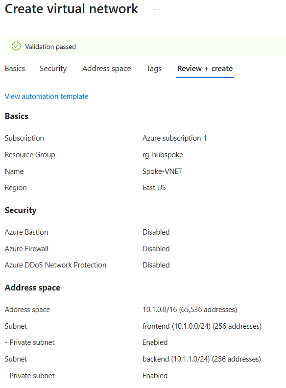

*Figure: Spoke VNet review: 10.1.0.0/16 with frontend (10.1.0.0/24) and backend (10.1.1.0/24) subnets*


### Step 3: Create the hub VNet with the firewall subnet

The hub VNet exists to hold the firewall. Its subnet must be named exactly `AzureFirewallSubnet` and be at least /26. I used 10.0.0.0/26 inside a 10.0.0.0/16 address space. I did not deploy the firewall yet, because it is billed hourly.

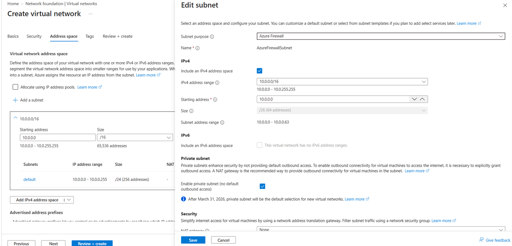

*Figure: Hub VNet: AzureFirewallSubnet configured as 10.0.0.0/26 (64 addresses)*

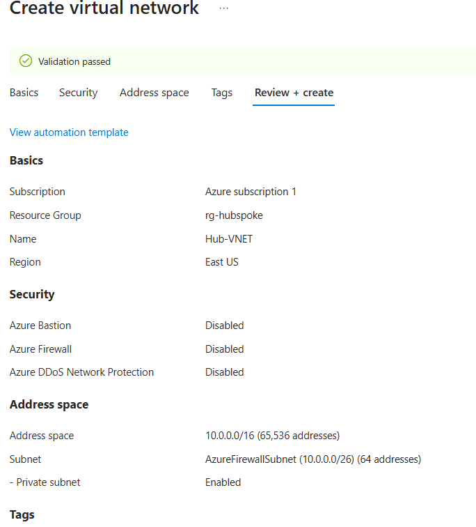

*Figure: Hub VNet review: 10.0.0.0/16 with AzureFirewallSubnet*

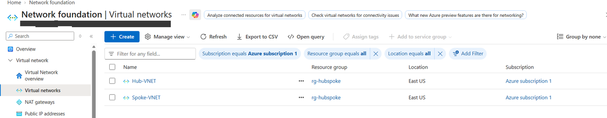

*Figure: Both VNets (Hub and Spoke) created in the same region*


### Step 4: Peer the VNets

I peered the spoke VNet with the hub VNet. In both directions I allowed access between the networks and allowed forwarded traffic, and left the gateway and route server options off.

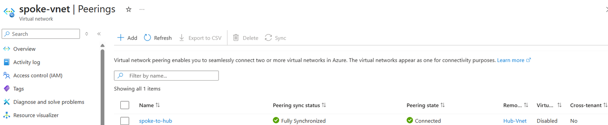

*Figure: Spoke VNet peering list: fully synchronized and connected*

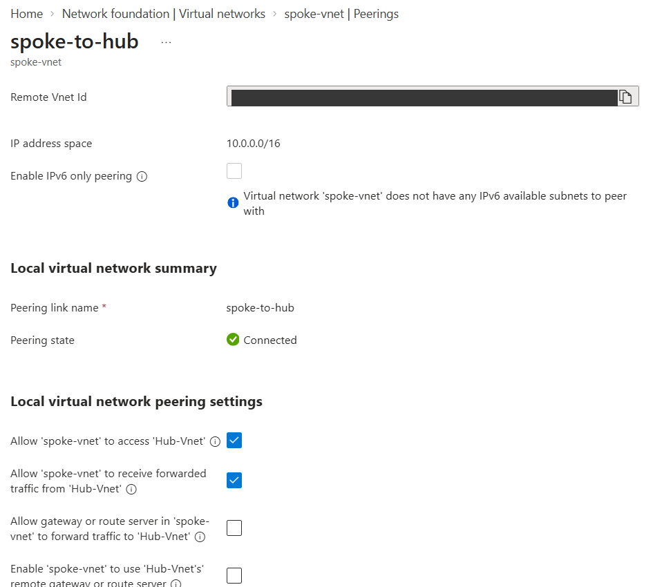

*Figure: spoke-to-hub peering: connected, with forwarded traffic allowed from the hub*

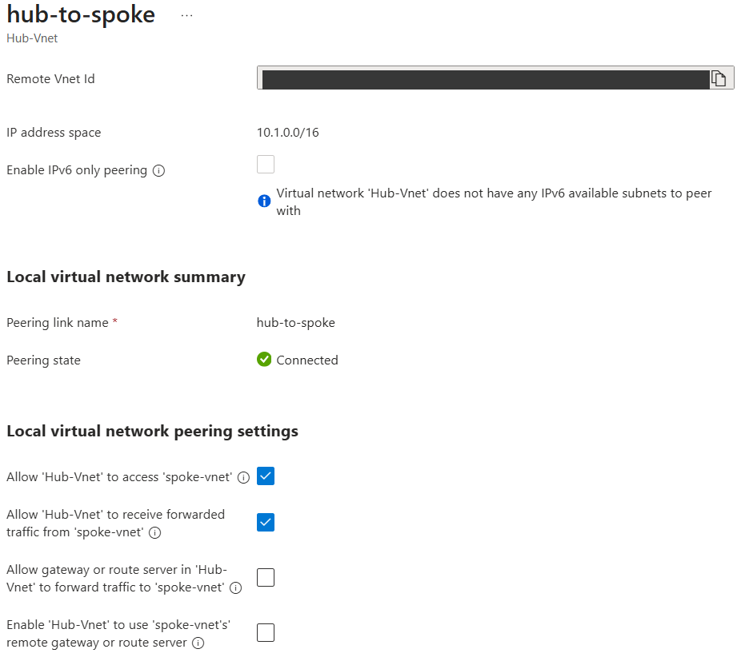

*Figure: hub-to-spoke peering: connected, with forwarded traffic allowed from the spoke*


### Step 5: Create the route table (UDR)

- Route table `rt-spoke`
- Route `default-to-firewall`: destination 0.0.0.0/0, next hop type Virtual appliance, next hop address 10.0.0.4
- Associated with the `frontend` and `backend` subnets
- Not associated with `AzureFirewallSubnet`

The firewall did not exist yet, but I could set the next hop in advance because 10.0.0.4 is the first usable address in the firewall subnet. Until the firewall exists the VMs have no outbound internet access, which is expected.

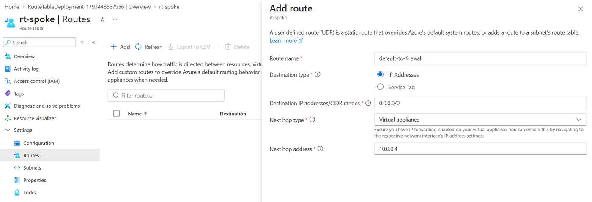

*Figure: Route table rt-spoke: default-to-firewall route, 0.0.0.0/0 to virtual appliance 10.0.0.4*

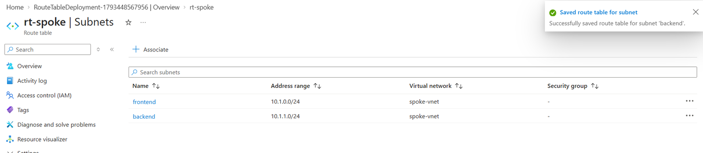

*Figure: rt-spoke associated with the backend subnet (and frontend)*

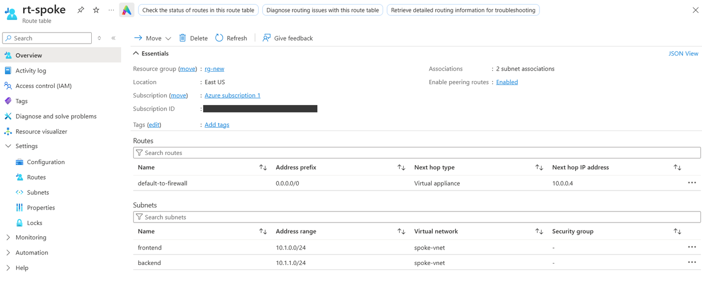

*Figure: rt-spoke summary: default route and two associated subnets (frontend, backend)*


### Step 6: Create the firewall public IP and the Log Analytics workspace

The public IP `fw-hub-pip` is IPv4, Standard SKU, regional and static (zone-redundant in my deployment). A Standard static address is required for Azure Firewall, and its address does not change, which matters because the DNAT rules refer to it. I created the workspace `law-hubspoke` at the same time so logging could be switched on as soon as the firewall existed.

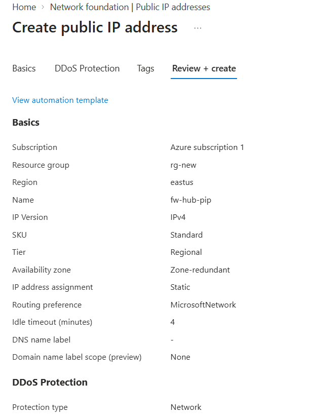

*Figure: Firewall public IP review: Standard SKU, static, regional*

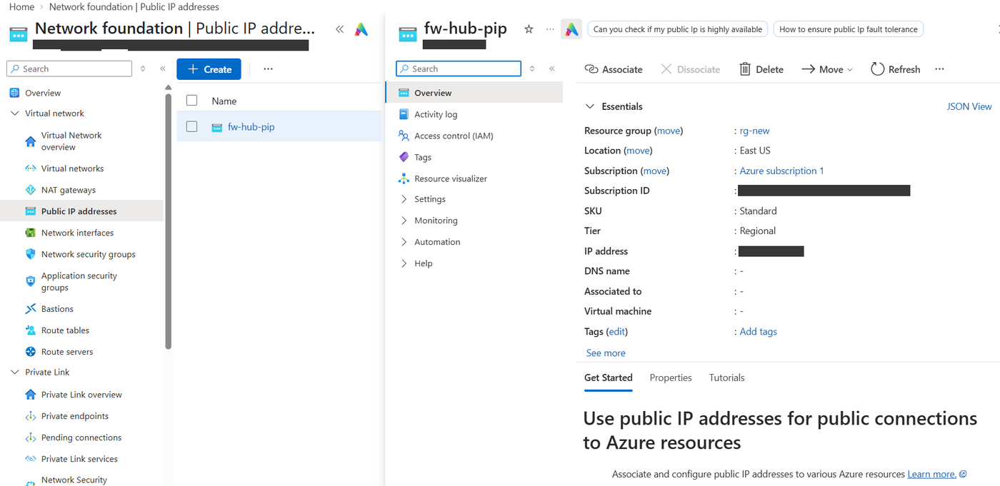

*Figure: fw-hub-pip created (address hidden)*

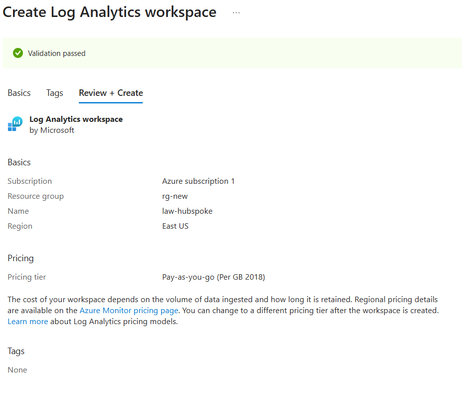

*Figure: Log Analytics workspace law-hubspoke review (pay-as-you-go)*

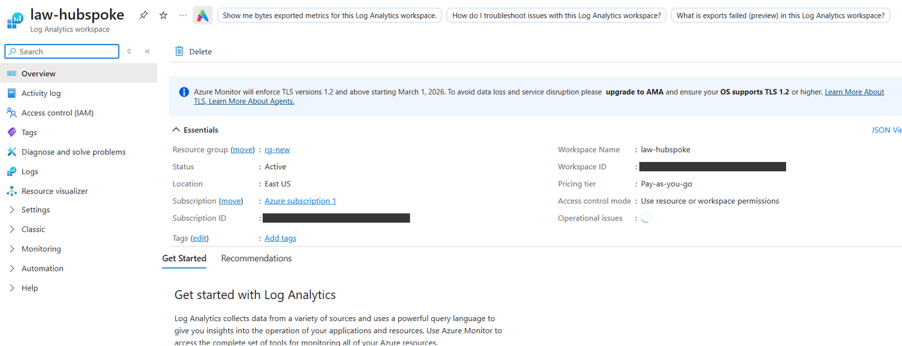

*Figure: law-hubspoke deployed in East US (IDs hidden)*


### Step 7: Create the firewall policy and its rules

Azure Firewall denies everything that is not explicitly allowed, so the policy needs rules for two things: reaching the VMs (DNAT) and letting the VMs reach approved websites (application rule).

| Collection | Rule | Settings |
|---|---|---|
| `DNAT-SSH` (DNAT, priority 100) | `ssh-frontend` | Source: my own public IP; TCP; destination port 2222; destination: the `fw-hub-pip` address; translated to 10.1.0.4 port 22 |
| `DNAT-SSH` (DNAT, priority 100) | `ssh-backend` | Source: my own public IP; TCP; destination port 2223; destination: the `fw-hub-pip` address; translated to 10.1.1.4 port 22 |
| `allow-web` (Application, priority 200, Allow) | `allow-microsoft` | Source 10.1.0.0/16; https:443; FQDNs `learn.microsoft.com` and `www.microsoft.com` |

> **A mistake I made and fixed:** my first DNAT rules had the firewall's own public IP as the source and its private IP as the destination. Creating the firewall then failed validation, because the destination of every DNAT rule must match the firewall's public IP. The source must be the address you connect *from* (my own public IP) and the destination must be the address you connect *to* (the firewall's public IP).

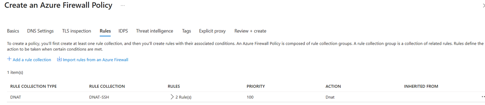

*Figure: Firewall policy creation: DNAT-SSH rule collection with two rules*

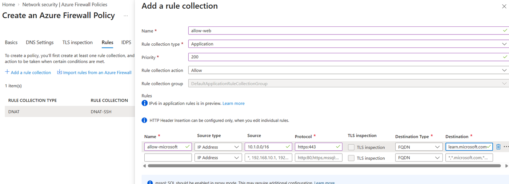

*Figure: Application rule collection allow-web: HTTPS to learn.microsoft.com and www.microsoft.com*

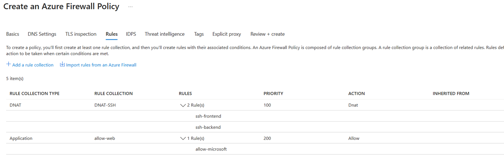

*Figure: Policy rules summary: DNAT-SSH (priority 100) and allow-web (priority 200)*

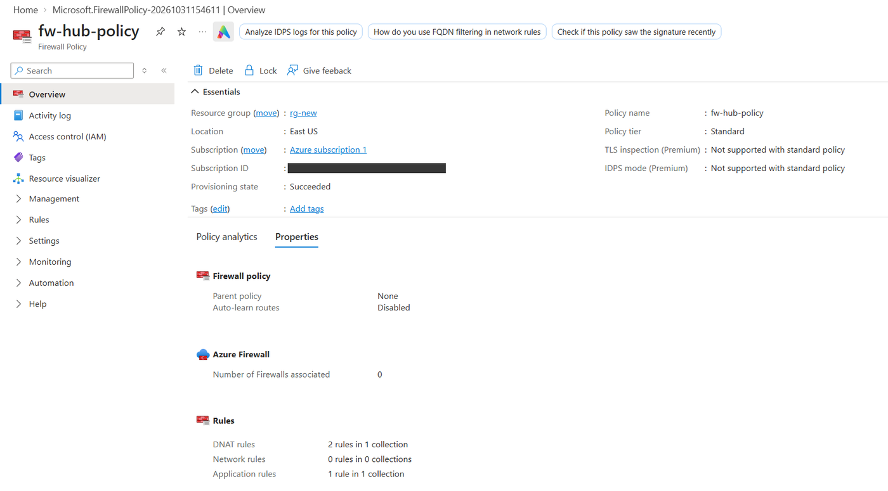

*Figure: fw-hub-policy deployed (Standard tier, not yet attached to a firewall)*

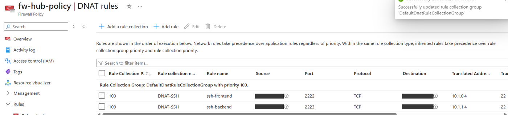

*Figure: DNAT rules ssh-frontend (2222 to 10.1.0.4:22) and ssh-backend (2223 to 10.1.1.4:22); source and destination hidden*


### Step 8: Deploy the VMs without public IPs

| Setting | frontend-vm | backendVM |
|---|---|---|
| Image | Ubuntu Server 24.04 LTS | Ubuntu Server 24.04 LTS |
| Size | Standard D2as v4 | Standard D2as v4 |
| Authentication | SSH public key, user `azureuser`, new key pair | SSH public key, user `azureuser`, new key pair |
| Public inbound ports | None | None |
| Subnet | `frontend` in `spoke-vnet` | `backend` in `spoke-vnet` |
| Public IP | None | None |
| Private IP (assigned) | 10.1.0.4 | 10.1.1.4 |

The private addresses matched the translated addresses I had already typed into the DNAT rules, so no rule needed correcting. The default NSG rule `AllowVnetInBound` accepts traffic from the peered hub network, which is where the DNAT traffic arrives from (the firewall's private address). The private key files (`.pem`) stay on my computer and are never uploaded to GitHub.

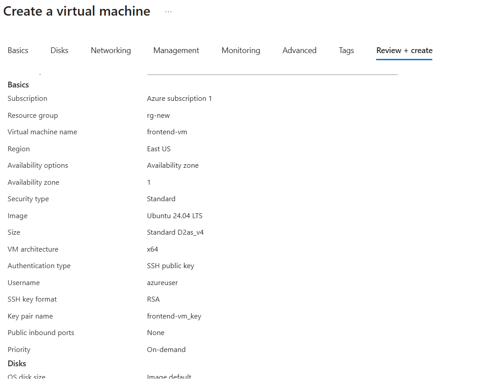

*Figure: frontend-vm review: Ubuntu 24.04 LTS, Standard D2as v4, SSH public key, no public inbound ports*

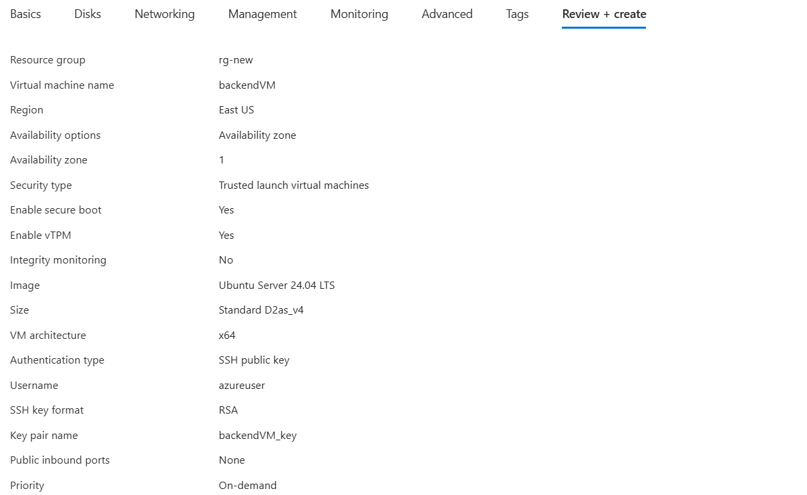

*Figure: backendVM review: Ubuntu 24.04 LTS, Standard D2as v4, SSH public key, no public inbound ports*

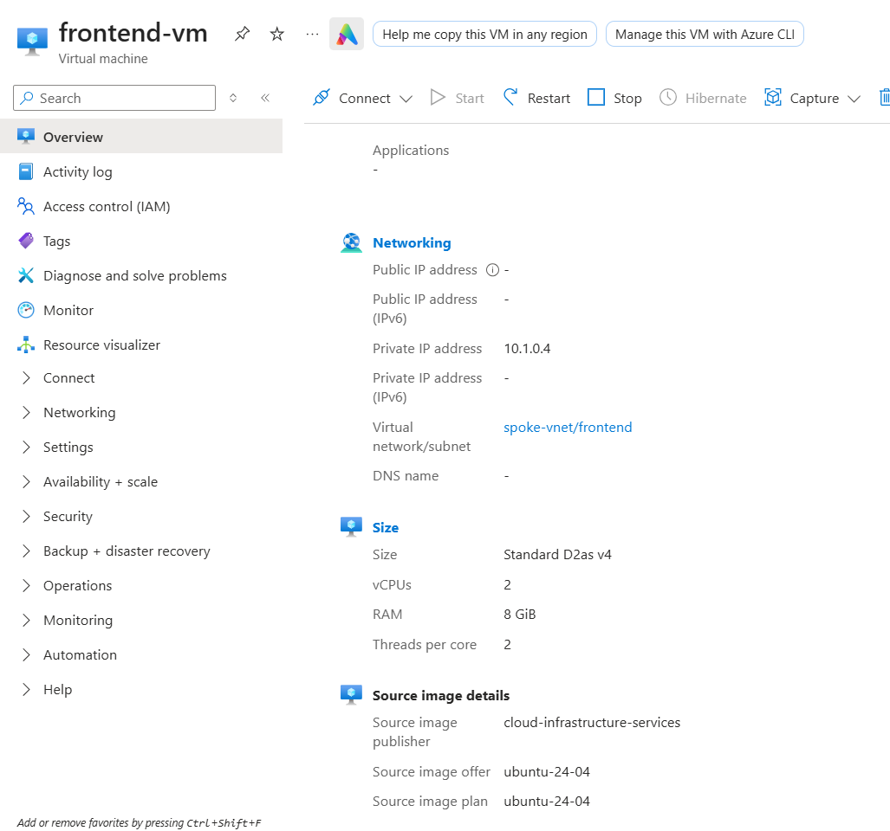

*Figure: frontend-vm overview: no public IP, private IP 10.1.0.4, subnet frontend*

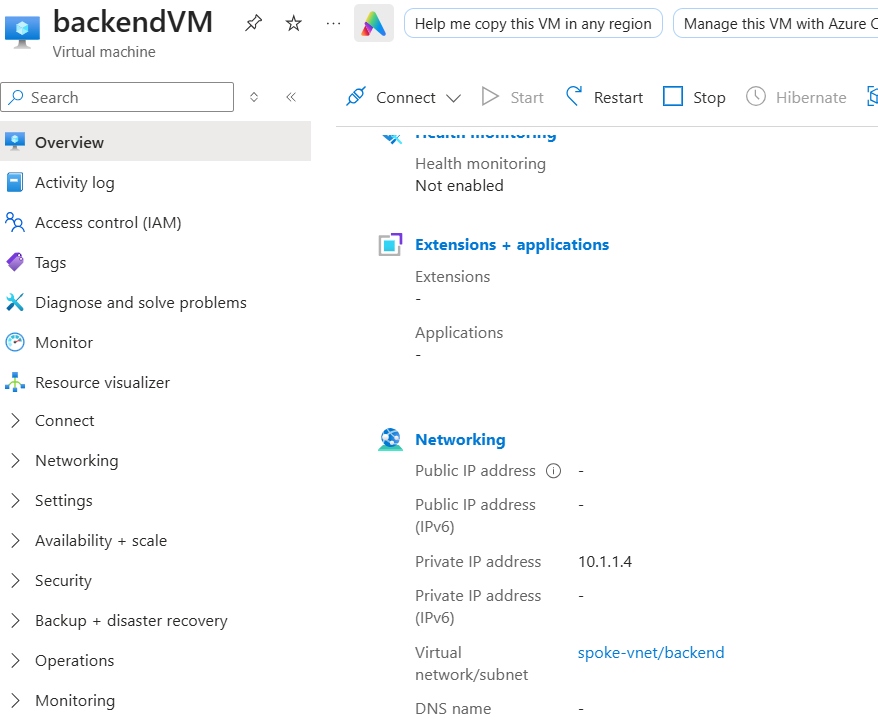

*Figure: backendVM overview: no public IP, private IP 10.1.1.4, subnet backend*

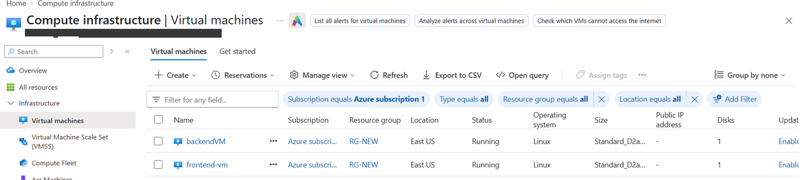

*Figure: Both VMs running with no public IP address*


### Step 9: Pre-flight check before deploying the firewall

Because the firewall is billed from the moment it is created, I checked everything first:

- `Hub-Vnet` has `AzureFirewallSubnet` (10.0.0.0/26).
- Peering is connected on both sides, with forwarded traffic allowed.
- Both VMs exist, have no public IP, and their private IPs are noted.
- `rt-spoke` has 0.0.0.0/0 to 10.0.0.4 and is associated with both spoke subnets.
- `fw-hub-pip` exists (Standard, static) and its address is noted.
- `law-hubspoke` exists.
- `fw-hub-policy` has the DNAT rules (with the right addresses and my current public IP) and the application rule.
- The SSH key files are saved, and I am on the same network (same public IP) that I put in the DNAT rule.


### Step 10: Deploy Azure Firewall (last)

| Setting | Value |
|---|---|
| Name / region | `fw-hub`, East US |
| SKU | Standard |
| Firewall management | Use a firewall policy: existing `fw-hub-policy` |
| Virtual network | Use existing: `Hub-Vnet` |
| Public IP | Existing `fw-hub-pip` |
| Management NIC | Left unticked |

If the management NIC box is ticked, deployment asks for a subnet named `AzureFirewallManagementSubnet`. Leaving it unticked avoids that error. Deployment takes several minutes.

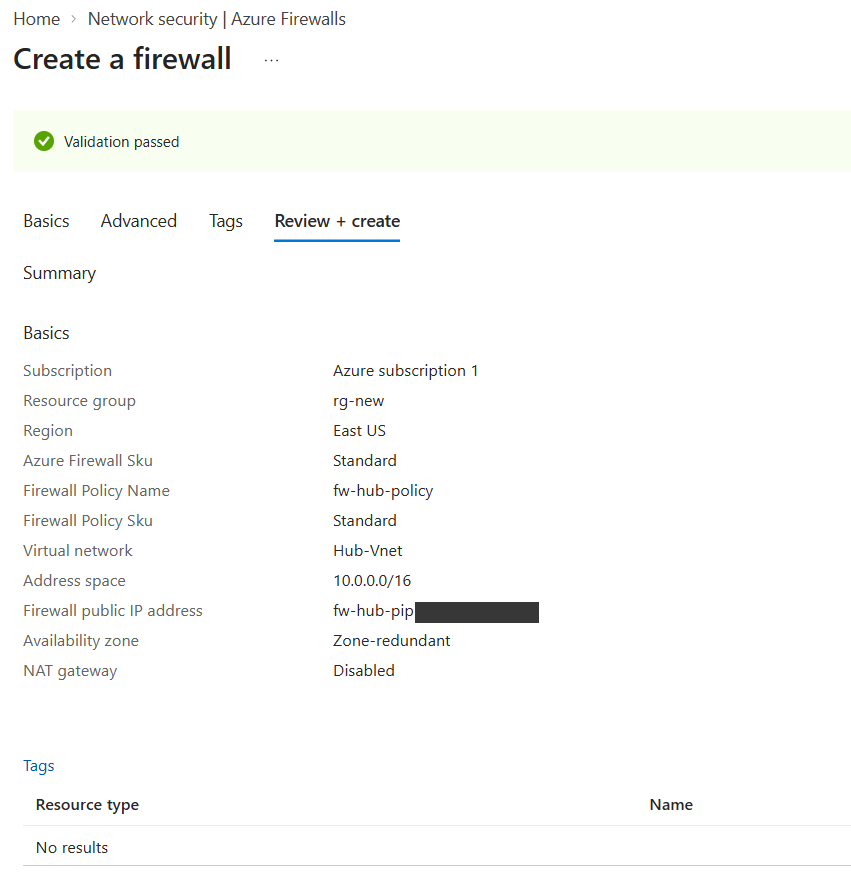

*Figure: Create a firewall review: Standard SKU, policy fw-hub-policy, Hub VNet, public IP fw-hub-pip*


### Step 11: Verify the firewall and turn on logging

The provisioning state changed to Succeeded and the private IP was 10.0.0.4, the same address I had already used in the route, so no change was needed. I then created the diagnostic setting `fw-logs`, sending the application, network and NAT rule logs to `law-hubspoke`.

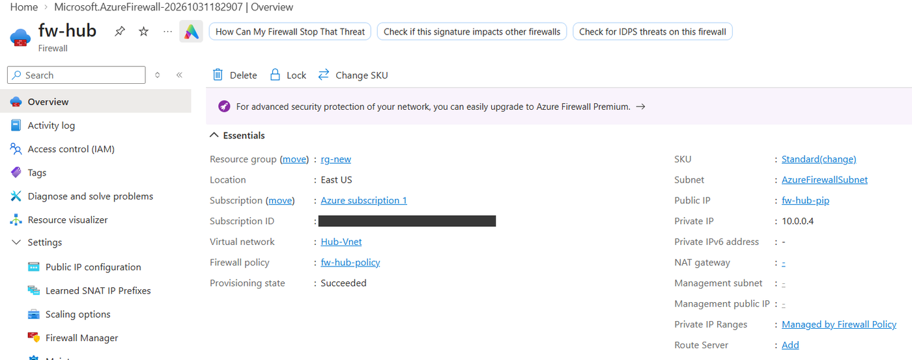

*Figure: fw-hub provisioning state Succeeded, private IP 10.0.0.4*

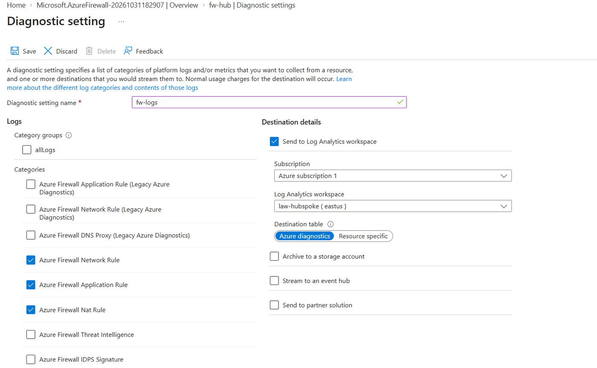

*Figure: Diagnostic setting fw-logs: firewall rule logs sent to law-hubspoke*


## 5. Tests and results


### Test 1: SSH to a private VM through the firewall

```
ssh -i .\frontend-vm_key1.pem -p 2222 azureuser@<FIREWALL-PUBLIC-IP>
```

**Observed:** the login succeeded and showed the prompt `azureuser@frontend-vm` with eth0 at 10.1.0.4. A later login banner showed `Last login ... from 10.0.0.6`, which is a firewall address and not my computer. That is the DNAT rule at work: the firewall translates the connection, so the request and the reply both pass through it.

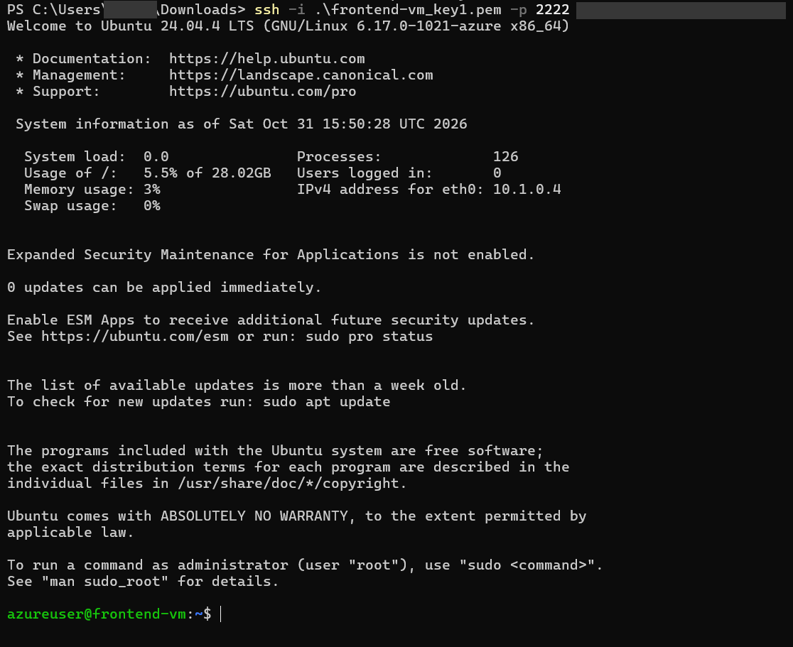

*Figure: SSH to frontend-vm through the firewall public IP on port 2222 (eth0 10.1.0.4)*


### Test 2: Outbound traffic, allowed and blocked

```
curl -I https://learn.microsoft.com
curl -I --max-time 10 https://www.example.com
```

**Observed:** `learn.microsoft.com` returned `HTTP/2 302`, a normal redirect to `/en-us/`, so the request got through. `www.example.com` failed with `curl: (35) SSL_ERROR_SYSCALL` and exit code 35. For HTTPS, the firewall checks the site name at the start of the connection against the application rules. The name is not allowed, so it drops the connection without any "access denied" page.

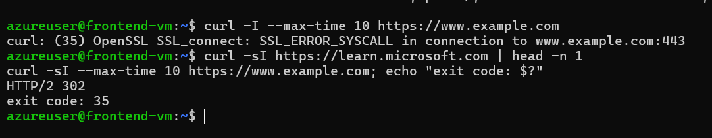

*Figure: curl to learn.microsoft.com returns HTTP/2 302 (allowed); curl to www.example.com fails with exit code 35 (blocked)*


### Test 3: Next hop for internet-bound traffic

Network Watcher's next hop tool shows where Azure will send traffic from a VM. For a destination on the internet (8.8.8.8) from both VMs, the next hop type was **VirtualAppliance** with IP address **10.0.0.4**, which is the firewall. This confirms the route table is working for both subnets.

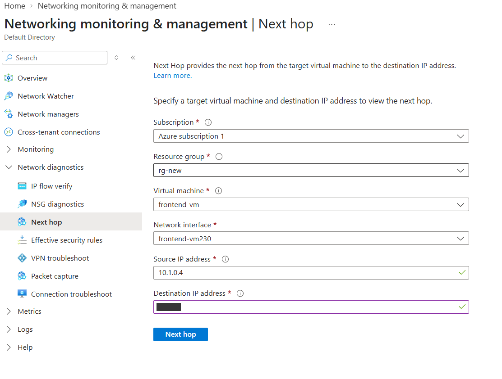

*Figure: Network Watcher next hop: frontend-vm to 8.8.8.8*

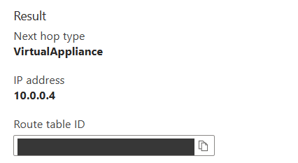

*Figure: Next hop result: VirtualAppliance 10.0.0.4*

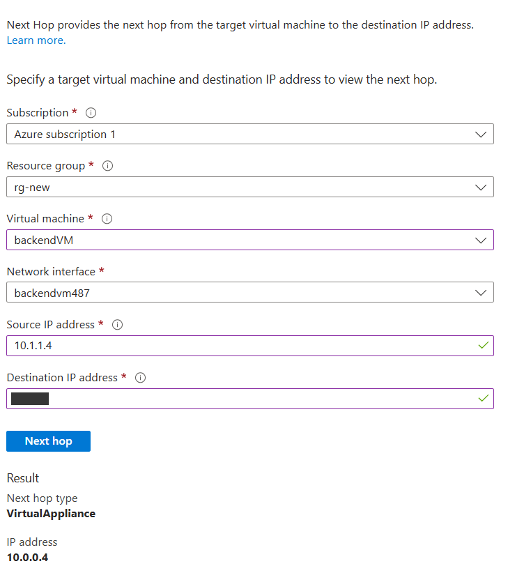

*Figure: Next hop from backendVM to 8.8.8.8: VirtualAppliance 10.0.0.4*


### Test 4: VM-to-VM traffic through the firewall

By default, traffic between two subnets of the same VNet uses Azure's system route and never reaches the firewall, because the VNet's own address range is more specific than 0.0.0.0/0. To bring it through the firewall I added two routes to `rt-spoke` (one for 10.1.1.0/24 and one for 10.1.0.0/24, both with next hop type virtual appliance and address 10.0.0.4) and a network rule collection `allow-eastwest` (priority 300) allowing ICMP in both directions between the two subnets.

- Next hop from `frontend-vm` to 10.1.1.4 changed to **VirtualAppliance 10.0.0.4**.
- `ping -c 4 10.1.1.4` succeeded: 4 of 4 replies, 0% packet loss, `ttl=63`. A TTL of 63 instead of 64 is consistent with one extra routing hop; the next hop result is the definitive evidence.

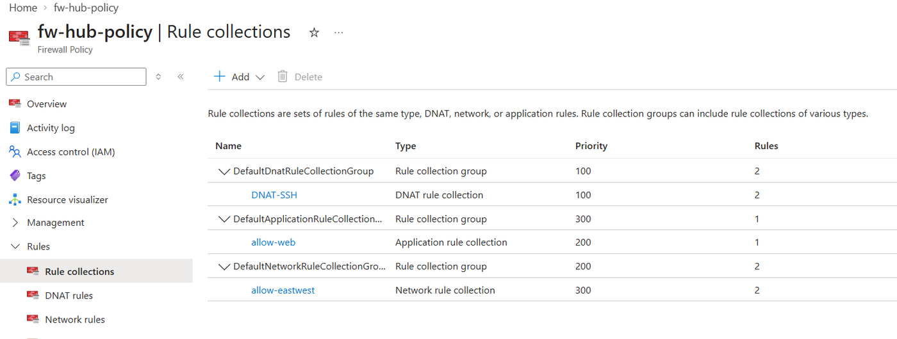

*Figure: Policy rule collections including allow-eastwest (network rules, priority 300)*

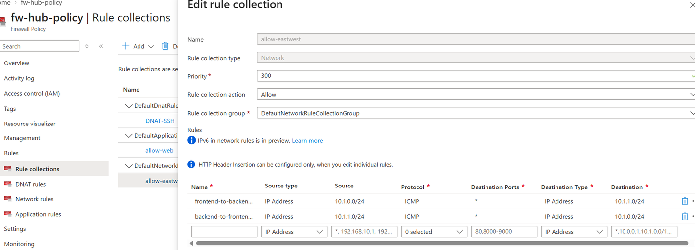

*Figure: allow-eastwest rules: ICMP between 10.1.0.0/24 and 10.1.1.0/24 in both directions*

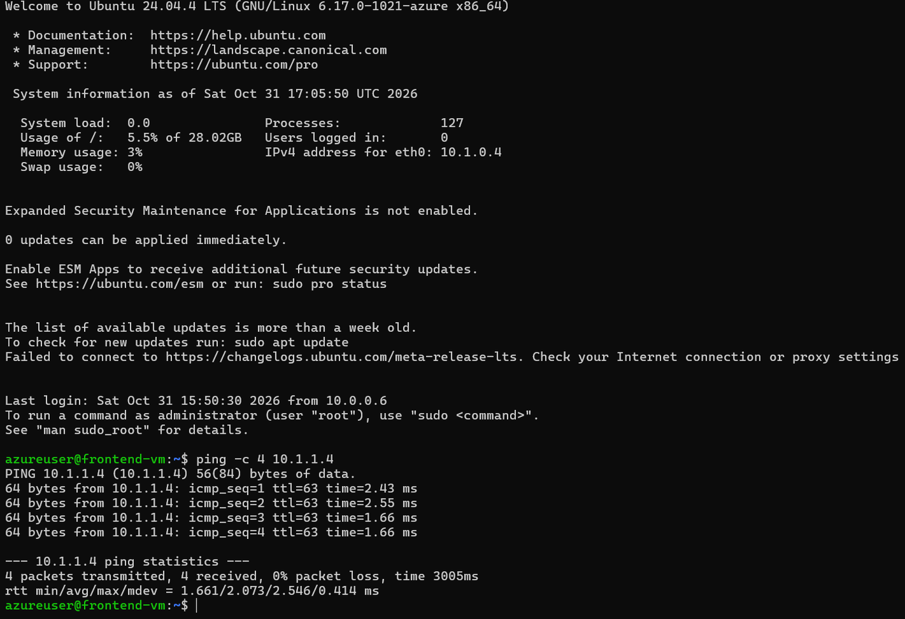

*Figure: ping from frontend-vm to 10.1.1.4: 4 of 4 replies, 0% loss, ttl=63*

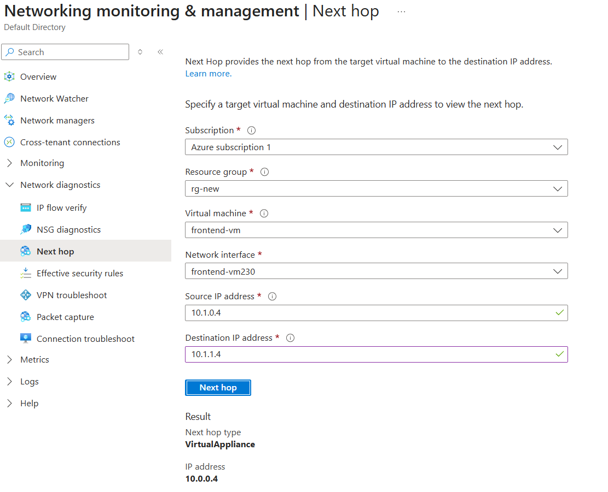

*Figure: Next hop from frontend-vm to 10.1.1.4: VirtualAppliance 10.0.0.4*


### Test 5: Remove the rule and confirm traffic is blocked

I deleted the `allow-eastwest` rule collection, waited for the policy to update, and pinged again. The result was 4 packets transmitted, 0 received, **100% packet loss**. The same traffic that worked with the rule now fails without it, which shows the firewall controlling traffic between the subnets.

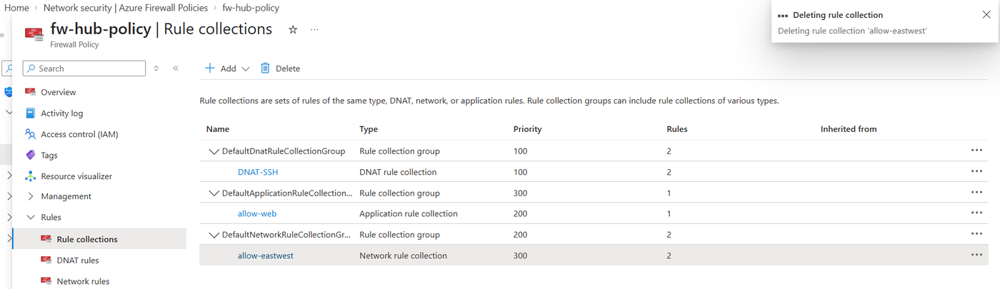

*Figure: Deleting the allow-eastwest rule collection*

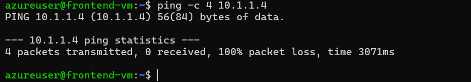

*Figure: ping from frontend-vm to 10.1.1.4 after deleting the rule: 100% packet loss*


### Test 6: Firewall metrics

Azure Firewall records metrics without any setup. Over a four-hour window the application rule chart showed 2 allowed and 8 denied hits, and the network rule chart showed a steady stream of denied hits with very few allowed. I did not identify the source of every denied hit. Some is background traffic from the VMs; for example, the Ubuntu login message reported a failed connection to `changelogs.ubuntu.com`, a site my rules do not allow. This is consistent with the firewall's default-deny behaviour.

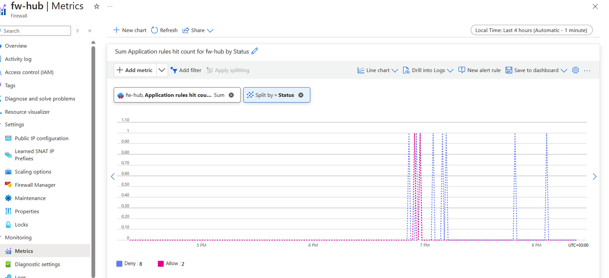

*Figure: Firewall metric: application rules hit count by status (Allow 2, Deny 8)*

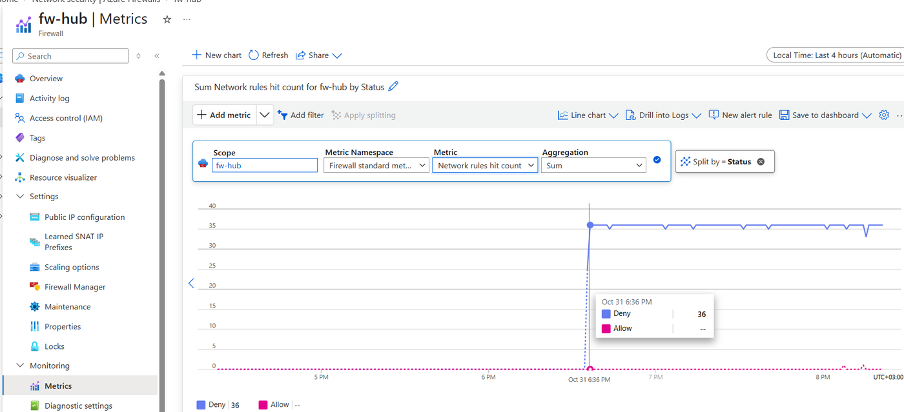

*Figure: Firewall metric: network rules hit count by status (sustained Deny)*


## 6. Results summary

| Test | Expected | Observed |
|---|---|---|
| SSH through the firewall (port 2222) | Login to frontend-vm with no public IP | Success; login source shown as a firewall address (10.0.0.6) |
| curl to learn.microsoft.com | Allowed | HTTP/2 302 |
| curl to www.example.com | Blocked | curl error 35, exit code 35 |
| Next hop to 8.8.8.8 (both VMs) | Firewall as next hop | VirtualAppliance 10.0.0.4 |
| Ping frontend-vm to backendVM with allow-eastwest | Allowed, via the firewall | 0% loss; next hop VirtualAppliance 10.0.0.4 |
| Ping after deleting the rule | Blocked | 100% packet loss |
| Firewall metrics | Allow and deny hits recorded | Application rules: 2 allowed, 8 denied; network rules: sustained denies |


## 7. Troubleshooting log

| Problem | Cause | Fix |
|---|---|---|
| In my first build, I could not SSH to a VM | The VMs had public IPs while the subnet default route pointed to the firewall. The likely cause is asymmetric routing: the reply leaves through the firewall, which never saw the request. | In the rebuild I removed the public IPs and reached the VMs through the firewall with DNAT rules. |
| Firewall creation failed validation: a DNAT destination did not match the firewall's public IP | My first DNAT rules had the source and destination fields wrong (firewall IP as source, private IP as destination). | Source set to my own public IP, destination set to the `fw-hub-pip` address. |
| SSH returned `Permission denied (publickey)` | I used the wrong key file name. Azure had saved the key as `frontend-vm_key1.pem`. | Used the exact file name with `-i`. |
| `ping -c` returned "Access denied" in PowerShell | I ran the Linux ping option on my Windows computer. | Ran the ping inside the VM after SSH. |
| Log queries on the `AZFW...` tables returned no results | See limitations below. | Used firewall metrics as evidence instead. |


## 8. Limitations

- **Firewall logs were not captured.** My queries on the `AZFWApplicationRule` and `AZFWNetworkRule` tables returned no results. In my diagnostic setting the destination table was set to *Azure diagnostics*, not *Resource specific*, which is the likely reason, because the `AZFW...` tables are only filled with the resource-specific option. I did not query the older `AzureDiagnostics` table, so I cannot confirm this. The setting was also created after the firewall, so earlier events were not recorded.
- **No "before" screenshot for VM-to-VM next hop.** I expect the next hop from `frontend-vm` to 10.1.1.4 to have been *Virtual network* before I added the extra routes, but I did not capture it, so I only describe it as expected behaviour.
- **The two extra routes for VM-to-VM traffic were not captured in a screenshot.** The `rt-spoke` screenshot shows only the default route.
- **Not every denied hit in the metrics is explained,** because the logs that would show the source and destination were not available.
- **Screenshots 01 to 04 come from an earlier build** in a different resource group with the same address plan.
- This is a small single-region lab with two VMs. It is not a production design.


## 9. Lessons learned

- Peering makes networks reachable. The UDR sends traffic to the firewall, and firewall rules decide what is allowed.
- A VM with a public IP behind a default route to a firewall can break inbound connections because of asymmetric routing. DNAT through the firewall keeps the path symmetric.
- Every DNAT rule's destination must be the firewall's public IP. The source is where the connection comes from.
- Traffic inside one VNet bypasses the firewall unless more specific routes send it there.
- Turn on diagnostic settings, with the right destination table, before running any tests.
- Cost control: prepare everything first, deploy the firewall last, test in one sitting, and delete the resource group afterwards.


## 10. Next steps (I will work on)

- Repeat the lab with diagnostic settings enabled first (resource-specific tables) and capture the rule logs.
- Add a second spoke and test spoke-to-spoke routing through the firewall.
- Use Azure Bastion or a jump host instead of DNAT for VM administration.
- Rebuild the lab with Bicep or Terraform.
- Add a network security group (NSG) to each spoke subnet as a second layer of control.


## 11. Cost control, cleanup and security

- **Cost:** Azure Firewall is billed for every hour it exists. Deploy it last and delete it (or the whole resource group) as soon as testing is finished.
- **Cleanup:** deleting the resource group `rg-new` removes the firewall, VMs, public IP, route table and VNets.
- **Keys:** the SSH private keys (`.pem` files) are not part of this repository and must never be uploaded.
- **Screenshots:** account details, IDs and IP addresses were hidden before publishing.


## Author

Marouf Ali, Madinah, Saudi Arabia. Microsoft Certified: Azure Administrator Associate (AZ-104) and Azure Fundamentals (AZ-900).
